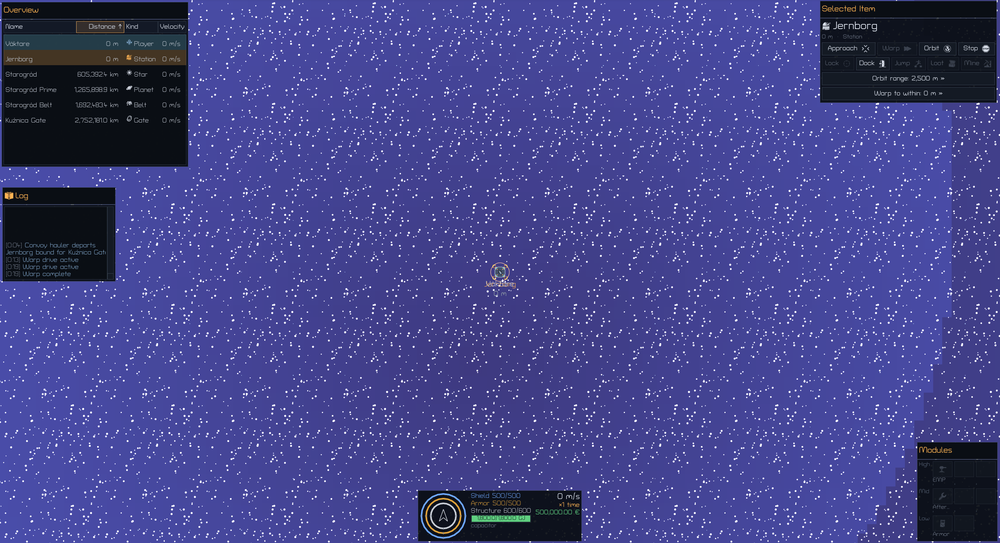
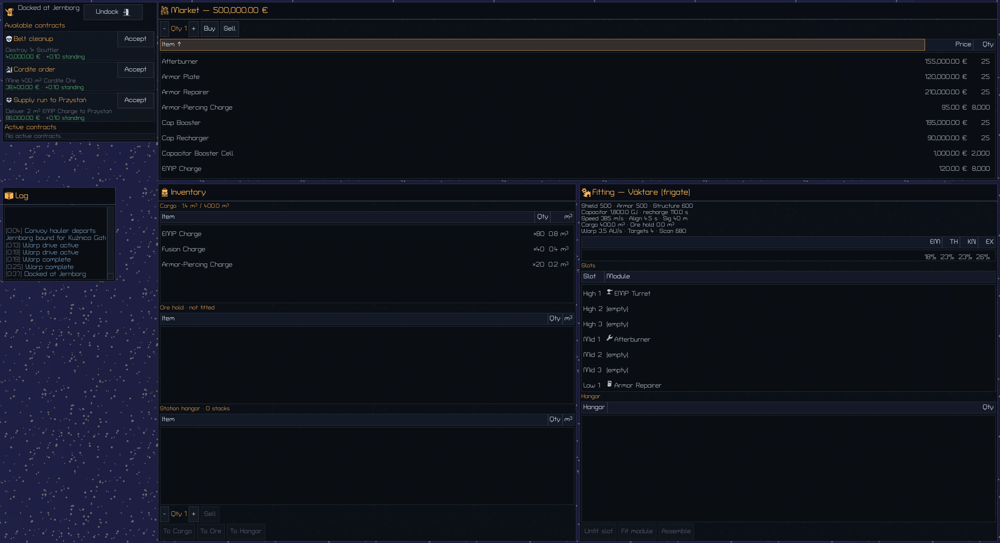
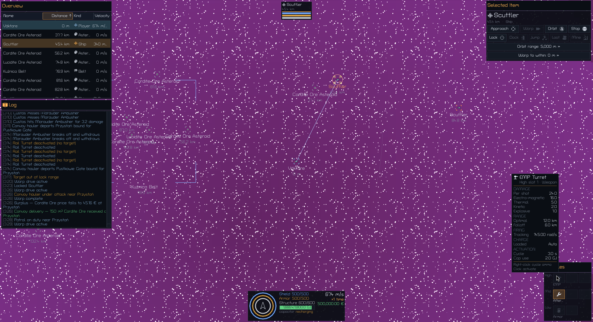

# Entieve

Entieve is a single-player 2D space sandbox in Go (Ebitengine). You fly one
ship through a seven-system star cluster: you take jobs, mine asteroids, fight
rats, haul ore, trade, and spend the money on ships and modules. The rules are
modelled on EVE Online — four damage types, shield/armor/structure, capacitor,
turret tracking — and the whole thing runs locally on your machine.

```
go run ./cmd/entieve run        # play
go test ./...                   # the whole test suite (headless, no GPU needed)
```

## Flying



*Undocked at Jernborg in the Starogród system. The overview lists everything
on grid, the Selected Item panel acts on the highlighted object, and the HUD
holds shield/armor/structure, speed, wallet and capacitor.*

You look down on one system at a time. Movement and orders are keyboard and
mouse: approach, orbit, align, stop, warp, dock, jump a gate, lock a target,
run a module. The overview only lists what is on your grid (250 km) — anything
further out appears in the scanner as anonymous long-range contacts ("Ship
×3") until you go there. You warp to 0, 10 or 50 km of a destination, which
decides where you come out.

Most of flying is travel: station to belt to gate to the next system. Time
acceleration runs 1× to 8× to shorten the trips.

Windows toggle from the keyboard (`I`, `F`, `G`, `B`, `C`, `N`, `H`, `P`,
`Shift+L`) or from the **left navigation rail** — one glyph per window in
six sections (Ship, Trade, Industry, Station, World, Help & System).
Hover for the name and hotkey, click once to open (the window lands on
top) and again to close; an entry you cannot use in the current context
is grayed, never hidden, and the slim edge tab collapses the rail
between sessions (`rail_collapsed` in the settings sidecar). The rail is
derived from the window table, so every window is one row in it; the
Esc menu keeps its own key and the HUD and module rack are permanent
chrome with no entries.

## Stations



*Docked at Jernborg. Contracts on the left, the market with stock and prices
at the top, cargo and ore hold in the middle, the fitting window on the right.*

Docking opens exactly one window: the **station services view**, with
the docked-at identity, an **Undock** button, a **Cargo** button and one
button per service *this* station offers (repair, market, refine,
fitting; industry where it exists — an absent service is not offered)
over the contract board on the left. Market, inventory, fitting and the
factory are ordinary windows you open from it, their keys, or the left
rail — they tile to the right of it while docked, and undocking closes
the services view and leaves your own windows as they were. Contracts give you
specific work — destroy a named rat, mine a volume of ore, deliver cargo to
another system — and pay money and standing on completion. The market is an
order book: buying and selling take the best resting prices, with a broker
fee on buys and a sales tax on sells, and prices move only when real goods
trade hands — your trades, the agents' trades, or a convoy's fresh supply
arriving. Refining turns ore into minerals; the hangar stores ships and
modules between trips.

Fitting is slot-based: high slots take turrets and mining lasers, mid slots
take propulsion and electronic warfare, low slots take tank and repair. The
fitting window shows what each change does to the hull — shield/armor/structure,
capacitor and recharge, speed, alignment, signature, cargo, and resists per
damage type. There are four player hulls (Väktare, Kosa, Havíř, Furman), and
the market is where the parts come from.

## Combat and mining



*A fight at the Kuźnica belt. The locked target gets its own readout at the
top; the module panel on the right shows the turret's damage profile, optimal
range, falloff, tracking and capacitor use; the log records every shot.*

Mining is straightforward: lock the asteroid, switch on a mining laser, and the
ore lands in your ore hold. Combat is decided by numbers you can see. Whether
a turret hits depends on its tracking and range against the target's speed,
angle and signature; hits can be wrecking shots. Ammo changes the damage
profile across EM, thermal, kinetic and explosive, and every hull has its own
resists on shield, armor and structure, with damage overflowing from one layer
to the next. Guns, active tank and boosters all draw on the same capacitor,
which recharges on a curve of its own, so a fit is a trade-off.

Rats patrol the belts and defend them against miners and shooters, and they
behave differently across the cluster: skittish in Charter space, fighting to
the death out in the Unincorporated systems. Combat anomalies hide the boss
rats and the best loot. Lose your ship and you are not finished — your pod is
recovered and the insurer issues a fresh Väktare.

Controls and concepts: [docs/GAMEPLAY.md](docs/GAMEPLAY.md).

## Rules

- **Turrets** use the tracking formula
  (`0.5^((angular/(tracking·sig/40k))² + (max(0,d−optimal)/falloff)²)`) with
  wrecking shots, ammo that changes the damage profile, and resists across
  EM/thermal/kinetic/explosive.
- **Shield / armor / structure** with per-layer resists and overflow
  carry-over.
- **Capacitor** with EVE's recharge curve (peak at ~25%), boosters with
  charges, active tank that competes for the same cap as the guns.
- **Order-book economy.** Stations run repair, market, refine, fitting and
  (at industry stations) the factory; each market is a real order book with
  a broker fee, sales tax and escrow; ore refines into minerals; ships and
  modules live in the hangar. A roster of traders, miners and industrialist
  agents trades, mines and manufactures alongside you, and convoys haul
  real cargo between the systems.
- **Manufacturing.** Two-tier production — ore refines into minerals,
  recipes turn minerals into hulls, modules and charges — run as timed jobs
  at industry stations (factory window, `B`), with station craft that grows
  with every completed run.
- **Seven systems** in the Far Moravia frontier — the Kresy ring: Starogród
  and Rudnik (Charter space), Kuźnica, Młynów and Kamieniec (the Fringe),
  Pustkowie and Głusza (Unincorporated) — with escalating danger, stargates
  between them, and combat anomalies with boss rats. Rat temperament
  follows charter reach: Charter space rats are skittish, Unincorporated
  rats fight to the death.
- **Visibility.** The overview shows only the 250 km grid; the scanner sweeps
  for anonymous long-range contacts; warp-to-within (0/10/50 km) shapes
  landings.
- **Show Info.** Right-click any item where it appears for a flat EVE-style
  context menu (bold **Show Info** first) and one floating `<Name> — Info`
  window — description prose, stats, charges, market data, loot.
- **Time acceleration** (1×–8×).

## Custom art

Drop a PNG into `assets/` — `assets/hulls/ship-sloop.png`,
`assets/stations/cel-haven-rest.png` — and the game draws it instead of the
built-in vector art. No config: the file name is the content ID, any size
works, and every missing file falls back to the procedural art, so an empty
`assets/` plays exactly like the stock game. Convention, sizing and fallback
rules: [docs/ART.md](docs/ART.md).

## Typeface

The UI is set in **IBM Plex Sans** — Regular for body text, Medium for window
titles, table headers, buttons and HUD readouts — embedded from
`render/fonts/` alongside its license, so `IBM Plex Sans, SIL Open Font
License 1.1` ("Copyright 2018 The IBM Plex Sans Project Authors"
<https://github.com/noponies/turret-road>) is included in every binary
([`render/fonts/OFL.txt`](render/fonts/OFL.txt), [docs/ART.md](docs/ART.md)).

## Icons

The interface's glyphs come from
[game-icons.net](https://game-icons.net) — monochrome silhouettes embedded in
[`uikit/icons/`](uikit/icons), converted to white-alpha at load and tinted
from the palette (16/20/24 px on the type grid). They mark kinds in the
overview and HUD, actions on the Selected Item buttons, module classes on the
rack, objectives on contract rows, and the service window titles.

**License — CC BY 3.0**: every icon keeps its author credit — the full list
(name, slug, author, source, license) is
[`uikit/icons/CREDITS.md`](uikit/icons/CREDITS.md), and a test pins each PNG
to both a manifest entry and a credits line. Required wording: *Icons made by
{author}. Available on https://game-icons.net*.

## Architecture

```
cmd/entieve → game → {render, uikit} → sim → content → (core, ecs)
```

- [`sim/`](sim) is a fully deterministic fixed-timestep simulation
  (60 ticks/s) with **no rendering dependency**. Everything is driven through
  `sim.Command` values and observed through `sim.Event` values — the same
  interface that lets tests and AI agents play the game headlessly.
- [`content/`](content) is data-driven: ships, modules, items, NPCs, recipes,
  star systems and worlds are JSON under `content/data/`, loaded,
  cross-validated and embedded into the binary.
- [`ecs/`](ecs) is a minimal deterministic ECS; [`core/`](core) has the
  vector math and a golden-pinned SplitMix64 PRNG so twin runs are bit-identical.
- [`render/`](render), [`uikit/`](uikit), [`game/`](game) are the Ebitengine
  client.

Design notes: [docs/ARCHITECTURE.md](docs/ARCHITECTURE.md) (the binding
contract) and [docs/SIM.md](docs/SIM.md) (the simulation reference:
tick anatomy, world metabolism, the ledger-agent economy, price
formation).

## Tooling (humans and AI agents alike)

```sh
go run ./cmd/entieve validate                 # lint all content, cross-check refs
go run ./cmd/entieve describe mod-emp-turret  # introspect any content id (JSON)
go run ./cmd/entieve simulate \
    --world world-showcase --ticks 36000 \
    --script scripts/showcase.json            # headless run + report
go run ./cmd/entieve run --world world-default
```

`simulate` executes tick-scheduled command scripts — JSON steps like
`{"at_tick": 300, "action": "warp", "target": "Starogród Belt"}` — and prints
every event plus a final state report (wallet, grid, state hash). Adding
content without touching engine code is the intended workflow:
[docs/CONTENT_AUTHORING.md](docs/CONTENT_AUTHORING.md) covers it, including
"how to add a star system in 5 minutes".

## Worlds

- `world-default` — the normal game start at Starogród.
- `world-showcase` — the test world: exercises **every** feature in the game
  (see its `scenario` checklist) and powers the integration suite in
  [`tests/`](tests).

## Development

```sh
go test ./...        # unit + integration tests, headless
go vet ./...
gofmt -l .
```

Testing policy: heavy stdlib `testing` coverage per package; `sim` is
deterministic (twin-run hash equality is asserted); `content` always loads and
validates the real data; `tests/` proves the showcase world exercises every
feature end-to-end.

License: MIT (the bundled IBM Plex Sans fonts: SIL Open Font License 1.1).
